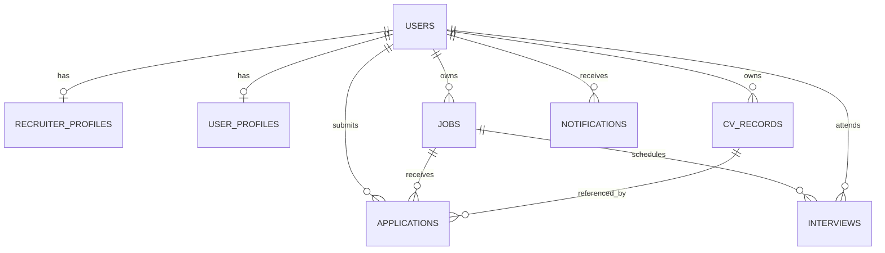

# Entity Relationship Documentation

**Status:** Current entities below are derived from SQLAlchemy declarations in `Hire-geni/backend/models.py`. This is not a verified live-database schema. The separate Analyzer has no active database model. Proposed unified-platform entities are explicitly separated below.

## 1. Current Hire-geni entities

Types below are SQLAlchemy-declared types; physical SQLite storage details may differ. `JSON` values are stored as SQLite-compatible serialized values by the ORM.

### `users`

| Attribute | ORM type | Key / constraints | Notes |
|---|---|---|---|
| `id` | Integer | PK, indexed | Local integer user identifier |
| `email` | String(320) | NOT NULL, unique, indexed | Login identifier |
| `full_name` | String(200) | NOT NULL | |
| `role` | String(20) | NOT NULL | Application values are `seeker` or `recruiter` |
| `password_hash` | String(255) | NOT NULL | Password hash, not plaintext |
| `is_active` | Boolean | NOT NULL, default true | |
| `created_at` | DateTime | NOT NULL, default UTC now | |

### `recruiter_profiles`

| Attribute | ORM type | Key / constraints | Notes |
|---|---|---|---|
| `id` | Integer | PK | |
| `user_id` | Integer | FK → `users.id`, NOT NULL, unique, indexed | Enforces at most one profile per user |
| `company_name` | String(200) | NOT NULL | |
| `company_website` | String(255) | Nullable | |
| `location` | String(200) | NOT NULL | |
| `industry` | String(100) | Nullable | |
| `company_description` | Text | Nullable | |
| `updated_at` | DateTime | NOT NULL; default/on update UTC now | |

### `user_profiles`

| Attribute | ORM type | Key / constraints | Notes |
|---|---|---|---|
| `id` | Integer | PK | |
| `user_id` | Integer | FK → `users.id`, NOT NULL, indexed; unique constraint `uq_profile_user` | At most one profile per user |
| `skills` | JSON | NOT NULL, default empty list | |
| `experience` | JSON | NOT NULL, default empty list | |
| `education` | JSON | NOT NULL, default empty list | |
| `phone` | String(50) | Nullable | PII |
| `address` | String(255) | Nullable | PII |
| `current_university` | String(200) | Nullable | |
| `updated_at` | DateTime | NOT NULL, default UTC now | |

### `jobs`

| Attribute | ORM type | Key / constraints | Notes |
|---|---|---|---|
| `id` | Integer | PK, indexed | |
| `recruiter_id` | Integer | FK → `users.id`, NOT NULL, indexed | Current owner is an individual recruiter |
| `title` | String(200) | NOT NULL | |
| `description` | Text | NOT NULL | |
| `experience_level` | String(50) | NOT NULL, default `entry` | |
| `required_skills` | JSON | NOT NULL, default empty list | Typically skill/weight objects |
| `created_at` | DateTime | NOT NULL, default UTC now | |

### `cv_records`

| Attribute | ORM type | Key / constraints | Notes |
|---|---|---|---|
| `id` | Integer | PK | |
| `user_id` | Integer | FK → `users.id`, NOT NULL, indexed | Owner |
| `candidate_id` | Integer | NOT NULL, indexed | Per-user sequence in upload path |
| `filename` | String(300) | NOT NULL | Display filename |
| `toggle_view` | String(20) | NOT NULL | `normal` or `anonymized` |
| `original_text` | Text | NOT NULL | Sensitive resume content |
| `anonymized_text` | Text | NOT NULL | Redacted resume content |
| `removed` | JSON | NOT NULL | Captured values removed by anonymizer; sensitive |
| `extracted` | JSON | NOT NULL | Parsed resume fields |
| `scoring` | JSON | NOT NULL | Upload-time/generic score details |
| `explanations` | JSON | NOT NULL | Seeker/recruiter explanations |
| `recommendations` | JSON | NOT NULL | Recommendation list |
| `created_at` | DateTime | NOT NULL, indexed, default UTC now | |

Unique constraint `uq_cv_user_candidate` covers (`user_id`, `candidate_id`).

### `applications`

| Attribute | ORM type | Key / constraints | Notes |
|---|---|---|---|
| `id` | Integer | PK, indexed | |
| `job_id` | Integer | FK → `jobs.id`, NOT NULL, indexed | |
| `user_id` | Integer | FK → `users.id`, NOT NULL, indexed | Applicant |
| `cv_record_id` | Integer | FK → `cv_records.id`, NOT NULL | Resume used for application |
| `score` | Float | Default 0.0 | Job-fit score |
| `status` | String(20) | Default `applied` | Code uses `applied`, `shortlisted`, `rejected` |
| `reveal_status` | String(20) | Default `none` | Code uses `none`, `pending`, `approved`, `rejected` |
| `xai_explanation` | JSON | Nullable, default null | Job-specific explanations |
| `created_at` | DateTime | NOT NULL, default UTC now | |

Unique index `uq_application_job_user` on (`job_id`, `user_id`) enforces one application per user per job.

### `interviews`

| Attribute | ORM type | Key / constraints | Notes |
|---|---|---|---|
| `id` | Integer | PK, indexed | |
| `job_id` | Integer | FK → `jobs.id`, NOT NULL, indexed | |
| `user_id` | Integer | FK → `users.id`, NOT NULL, indexed | Seeker |
| `scheduled_at` | DateTime | NOT NULL | |
| `meeting_link` | String(500) | Nullable | |
| `status` | String(20) | Default `scheduled` | Model comment lists scheduled/completed/cancelled |
| `created_at` | DateTime | NOT NULL, default UTC now | |

### `notifications`

| Attribute | ORM type | Key / constraints | Notes |
|---|---|---|---|
| `id` | Integer | PK, indexed | |
| `user_id` | Integer | FK → `users.id`, NOT NULL, indexed | Recipient |
| `title` | String(200) | NOT NULL | |
| `message` | Text | NOT NULL | |
| `type` | String(20) | Default `info` | Model comment includes info/success/warning/reveal_request |
| `read` | Boolean | Default false | |
| `extra_data` | JSON | Default empty dict; nullable declaration | May carry application/job identifiers |
| `created_at` | DateTime | NOT NULL, default UTC now | |

## 2. Relationships and ownership

The ORM defines `User`→`RecruiterProfile` and `User`→`UserProfile` as one-to-one relationships; unique user foreign keys enforce that cardinality. A recruiter is represented by a `users` row with recruiter role and can own many jobs. Applications link a user and job, while the unique index allows at most one application for that pair. An application references one CV record; a CV record may be referenced by multiple applications. Interviews associate a job and seeker, but have no direct FK to `applications`. Notifications belong to one user.

There is no `organizations` table, organization membership, `admin` role, tenant key, application-to-interview FK, or Supabase Auth user ID in the current models.

## 3. Indexes and constraints verified in source

- Unique, indexed `users.email`.
- Unique, indexed `recruiter_profiles.user_id`.
- Unique `user_profiles.user_id` constraint and index.
- `uq_application_job_user` unique composite index; startup code attempts to add it if existing data is not duplicated.
- `uq_cv_user_candidate` unique constraint.
- Explicit indexes on user/job/application/CV identifiers and CV creation time as declared in `models.py`.
- Foreign keys are declared by SQLAlchemy. Enforcement behavior in any deployed SQLite database and live schema state were not independently inspected.

The startup migration in `Hire-geni/backend/main.py` adds user-profile columns with broad exception suppression and adds the application unique index when safe. `Hire-geni/backend/migrate_db.py` is a separate SQLite script for `xai_explanation`. These are not Supabase migrations.

## 4. Existing ERD differences

The original [Hire-geni ERD](legacy/hire-geni/ERD.md) describes the same broad entities but is less exact than the ORM. It does not list every implemented field/constraint and describes a candidate/job relationship in prose. The source of implementation truth for the current model is `backend/app/db/models.py` (formerly `Hire-geni/backend/models.py`). The PRD requests interview status tracking, but the inspected API provides no status-update route.

## 5. Proposed entities (not implemented)

The supplied target architecture requires a future Supabase data model, but no authoritative complete schema was approved or found. Potential entities such as `organizations`, organization memberships, platform admins, auth-linked profiles, storage metadata, and audit events are **proposals requiring product/security decisions**, not existing tables.

The candidate-platform planning document (`docs/hiregenii/CANDIDATE_PLATFORM_PLAN.md`) proposes additional resume-builder tables such as `resume_documents`, `resume_document_versions`, `resume_files`, `job_descriptions`, `ats_reports`, and related candidate tools. They are planning material only and do not belong to the implemented ERD.

No claim is made that a live Supabase project exists or contains any of these tables. See [system architecture](SYSTEM_ARCHITECTURE.md) and [roadmap](IMPLEMENTATION_ROADMAP.md).
