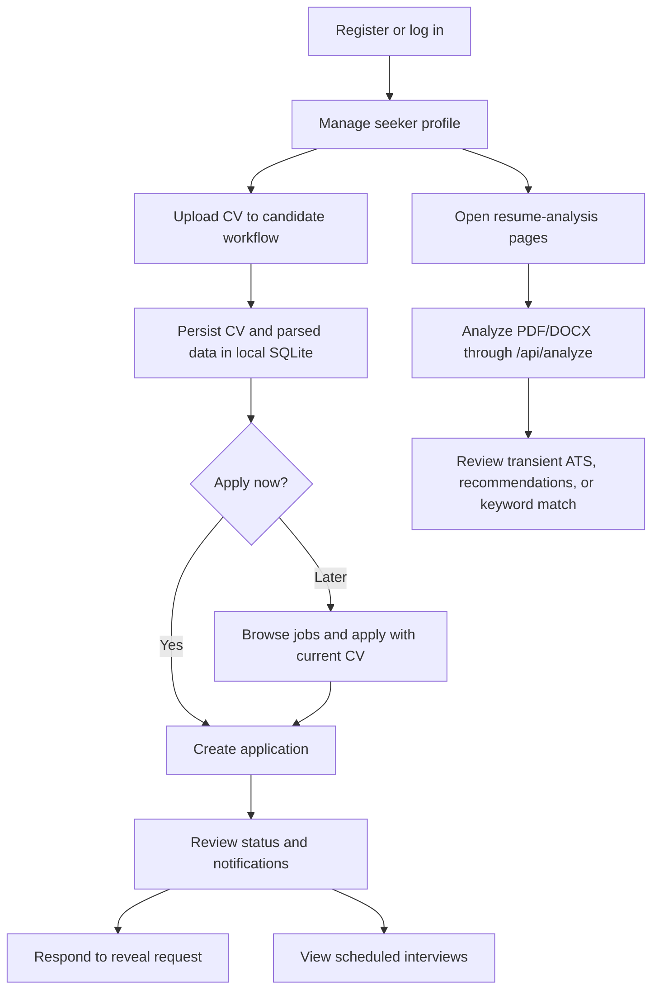
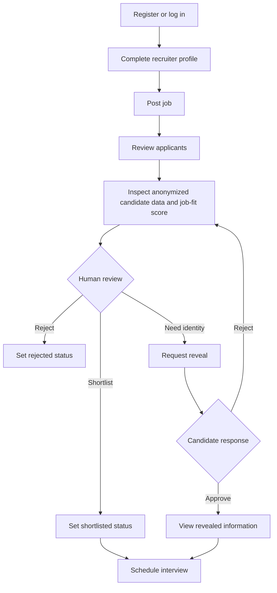

# Features and Workflows

Status is based on source inspection, not end-to-end execution:

- **Implemented but not verified:** a code path exists, but this documentation
  update did not exercise it.
- **Partially implemented:** some behavior exists, with notable gaps.
- **Not implemented:** no supporting implementation was found.
- **Proposed:** target/future feature only.

## 1. Feature inventory

| Feature | Role | Status | Frontend | Backend / data | Current boundary or limitation |
|---|---|---|---|---|---|
| Resume upload and analysis | Seeker | Implemented but not verified | `frontend/src/modules/job-seeker/resume-analysis/` | `/api/analyze`; `backend/app/modules/resumes/analysis_router.py` and `resume_engine/` | PDF/DOCX analysis is transient; API route has no auth dependency |
| Resume-quality ATS score | Seeker | Implemented but not verified | `frontend/src/modules/job-seeker/resume-analysis/pages/AtsReport.tsx` | Rule-based ATS engine | Quality score is distinct from job-fit scoring |
| Resume explorer and recommendations | Seeker | Implemented but not verified | `frontend/src/modules/job-seeker/resume-analysis/pages/ResumeExplorer.tsx` | Resume engine parser and recommendation modules | Results are held in frontend state, not analysis history |
| Skills dictionary | Seeker | Partially implemented | `frontend/src/modules/job-seeker/resume-analysis/pages/SkillsDictionary.tsx` | `/api/knowledge/skills`; in-memory repository | Alias changes reset when the backend restarts |
| Job-description keyword match | Seeker | Partially implemented | `frontend/src/modules/job-seeker/resume-analysis/pages/JobMatcher.tsx` | `POST /api/job-match` | Token/substring overlap, not semantic matching |
| Registration and login | Seeker/recruiter | Implemented but not verified | `frontend/src/modules/auth/` | `/auth/*`; custom JWT and local user records | Not Supabase Auth |
| Seeker profile | Seeker | Implemented but not verified | `frontend/src/modules/job-seeker/pages/SeekerProfile.tsx` | `/profile/me`; `user_profiles` | No organization tenancy |
| Recruiter profile | Recruiter | Implemented but not verified | `frontend/src/modules/recruiter/pages/RecruiterProfile.tsx` | `/profile/recruiter`; `recruiter_profiles` | One recruiter profile per user |
| Job posting and discovery | Recruiter/seeker | Implemented but not verified | `frontend/src/modules/recruiter/pages/PostJob.tsx`, `frontend/src/modules/job-seeker/pages/JobListings.tsx` | `/jobs*`; SQLite `jobs` | Job list/detail endpoints are public |
| Candidate CV upload and processing | Seeker | Implemented but not verified | `frontend/src/modules/job-seeker/pages/CVUpload.tsx`, `frontend/src/modules/job-seeker/pages/GeneralizedCV.tsx` | `/cv/upload`; agents and SQLite `cv_records` | Original and anonymized text plus removed PII are stored locally |
| Candidate identity reveal | Seeker/recruiter | Implemented but not verified | `frontend/src/modules/recruiter/pages/CandidateDetail.tsx` and seeker views | `/applications/*reveal*`; application reveal state | Source logic exists; requires security and workflow testing |
| Job-fit scoring and ranking | Recruiter/seeker | Partially implemented | `frontend/src/modules/recruiter/pages/CandidateScreening.tsx`, `frontend/src/modules/recruiter/pages/CandidateDetail.tsx` | Scoring agents; `/rank/{job_id}` | Heuristic score; not the resume-quality ATS score |
| Institute-bias comparison | Recruiter | Implemented but not verified | `frontend/src/modules/recruiter/pages/CandidateDetail.tsx` | `/bias-toggle/{candidate_id}` | What-if comparison only; not a hiring decision |
| Human shortlist/reject | Recruiter | Implemented but not verified | Screening, detail, and shortlist pages | Application status routes and SQLite `applications` | Explicit recruiter action; AI suggestions do not change status |
| Shortlist suggestions | Recruiter | Implemented but not verified | Recruiter dashboard/screening | `/jobs/{job_id}/shortlist-suggestions`; legacy `/auto-shortlist` alias | Read-only suggestions |
| Applications and status feedback | Seeker/recruiter | Partially implemented | Seeker dashboard and job pages | SQLite `applications`; `/applications/*` | Duplicate `GET /applications/my` declarations need contract verification |
| Interview scheduling/listing | Recruiter/seeker | Partially implemented | `frontend/src/modules/shared/pages/Interviews.tsx`, candidate detail | `/interviews*`; SQLite `interviews` | Creation/listing exists; no status-update route found |
| Notifications and live updates | Seeker/recruiter | Partially implemented | `frontend/src/layouts/DashboardHeader.tsx`, `frontend/src/hooks/useJobUpdates.tsx` | SQLite `notifications`; `/ws/jobs` | WebSocket manager is process-local |
| Unified application structure | All | Implemented; workflows remain distinct | One React/TypeScript app | One modular FastAPI process | Shared tree does not mean shared persistence or auth for every route |
| Admin tools | Administrator | Not implemented | None | Empty module placeholder | Role, permissions, and workflows are undecided |
| Organization management | Recruiter/platform | Not implemented | None | Empty module placeholder; no organization model | Tenant and membership rules are undecided |
| Supabase Auth/DB/RLS/Storage/Realtime | All | Proposed | No integration found | No client or migrations; local SQLite remains active | Live Supabase state was not inspected |
| Resume builder, versioning, cover letters, AI copilot | Seeker | Not implemented | No corresponding pages found | No current APIs/models | Discussed in planning material only |

## 2. Job seeker workflows

The seeker workflows share the same frontend. Account, profile, CV, job,
application, and interview operations use the authenticated candidate API.
Resume analysis is a separate endpoint flow under the seeker UI:

The resume-analysis result is not persisted and is not linked to application
history. Its frontend pages are under the protected seeker route, but the
analysis API handlers do not require a JWT.

## 3. Recruiter workflow

Shortlist suggestions and the institute-bias comparison are advisory/what-if
features; they do not themselves update application status. A recruiter must
take an explicit action to shortlist or reject an applicant.

## 4. Admin workflow

No admin workflow is documented by the existing PRD or implemented in source.
Admin authority, organization scope, audit requirements, and separation of
duties need product decisions before implementation.

## 5. Current known limitations

- One frontend and one API process now host the features, but resume analysis
  and candidate/recruiter workflows still have separate auth and persistence
  behavior.
- Resume-analysis API routes do not require authentication; analysis results
  are transient.
- Candidate records and resume files use local SQLite and filesystem storage.
- Supabase integration, organization membership, and admin workflows are not
  implemented.
- WebSocket delivery is in-process; multi-instance delivery is not provided.
- Interview status values exist, but no status mutation endpoint was found.
- `GET /applications/my` is declared more than once; confirm its effective
  contract before relying on a response shape.
- Workflows and route contracts were not end-to-end tested for this update.
