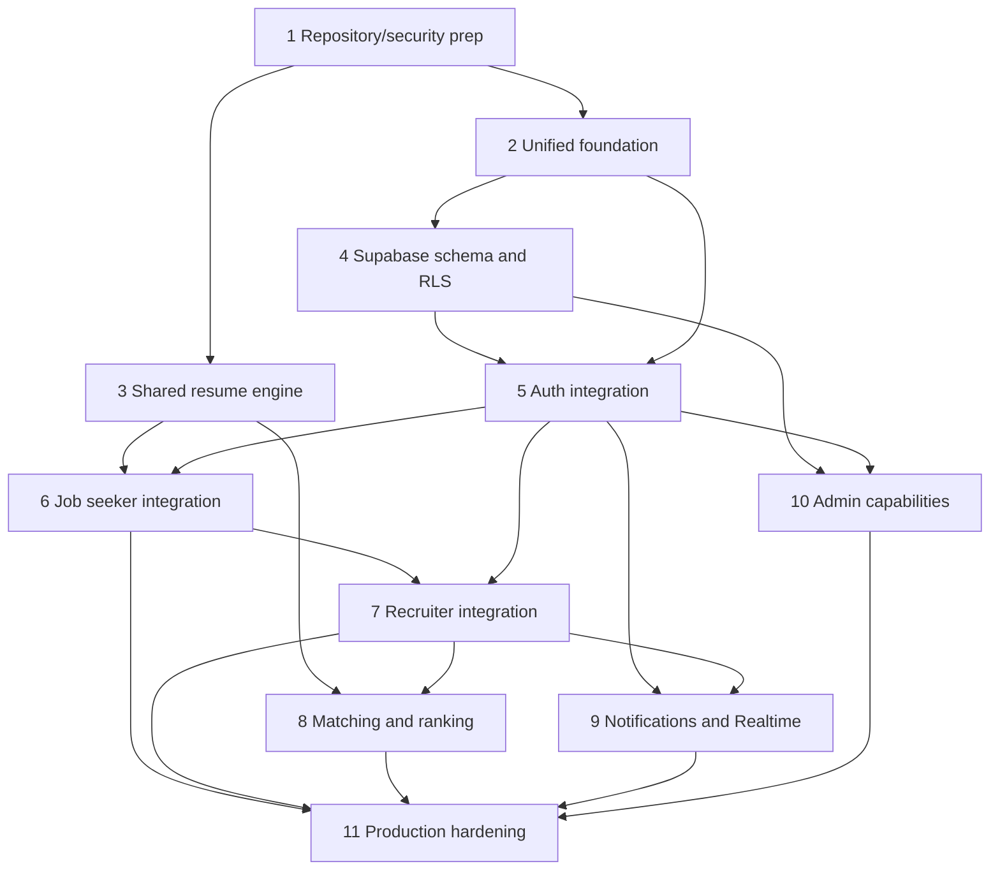

# HireGenii Implementation Roadmap

**Status:** Proposed sequencing only. This is not permission to implement. Each phase requires explicit scope approval, and product/data decisions must be resolved where listed.

## Target structure

**Status (2026-11-10): the repository now uses this structure.**

```text
hiregenii/
├── frontend/                    # one React + TypeScript frontend (from Hire-geni)
│   └── src/{app,components,modules,services,hooks,layouts,types,utils}/
│       └── modules/{auth,job-seeker,recruiter,admin,shared}/
├── backend/                     # one FastAPI backend
│   └── app/{api,core,db,modules,integrations,services}/
│       └── modules/{auth,candidates,resumes,resume_engine,jobs,applications,recruiters,
│                    interviews,notifications,organizations,admin}/
├── supabase/{migrations,functions}/   # placeholders; database work deferred
├── docs/
├── CLAUDE.md
└── README.md
```

The old trees were merged as follows:
- The analyzer API (`Backend/`) and the Hire-geni API (`Hire-geni/backend/`) became one app in `backend/app`, with every existing URL unchanged.
- The Hire-geni frontend became `frontend/`, and the analyzer screens were ported into `frontend/src/modules/job-seeker/resume-analysis/`.
- `organizations/` and `admin/` are empty placeholders; no Supabase files exist yet.

## Phases

| Phase | Objective and tasks | Prerequisites / dependencies | Deliverables and acceptance criteria | Risks / approval |
|---|---|---|---|---|
| 1. Repository and security preparation | Record current behavior and contracts; identify sensitive data; resolve doc/code conflicts; choose migration strategy and preserve both apps during transition | Approval of target layout; product scope and baseline | Inventory of current routes/data and a non-destructive migration plan; both existing apps remain runnable until explicitly retired | Moving/renaming files can break imports, scripts, and local data. Explicit approval required before any restructuring |
| 2. Unified project foundation | Establish `web/`, `api/`, `supabase/`, shared configuration, local developer setup, and CI using approved conventions | Phase 1; runtime and hosting choices | One frontend and one API skeleton build and run; existing behavior remains covered by migration checks | Dependency/version conflicts between React 19/Vite 8 Analyzer and React 18/Vite 5 Hire-geni |
| 3. Shared resume-engine extraction | Compare parsers, scoring semantics, formats, and provider behavior; extract only reusable Python processing behind stable interfaces | Phase 1 inventory; explicit approval of API/behavior contract | Shared engine handles approved PDF/DOCX cases and preserves documented outputs; no web/DB coupling in core | Existing two parsers and scores are not equivalent; avoid silently changing scoring or feature behavior |
| 4. Supabase schema and RLS | Approve identity/profile/organization/application/resume model; create additive migrations, RLS policies, and private storage rules | Product decisions on canonical accounts, organizations, admin, retention, and migration | Reviewed schema and migration set; owner/other-user/anonymous/recruiter access verified for each policy | No live schema verification or Supabase project state is available; data migration has privacy and loss risks |
| 5. Authentication integration | Integrate frontend and FastAPI with Supabase Auth; map roles and memberships; define token validation and session lifecycle | Phase 4 schema and RLS; identity mapping decision | One auth flow; protected APIs validate identity and enforce approved role/ownership rules | Existing local JWT accounts and passwords are not automatically portable; do not assume account migration |
| 6. Job seeker integration | Connect profiles, resume upload/analysis, job discovery, and applications through the unified contract | Phases 2–5; approved resume lifecycle and consent | Seeker can complete agreed workflow; private resume access and ownership checks verified | Analyzer has no durable account/history; Hire-geni stores raw text and files locally; migration decision required |
| 7. Recruiter integration | Connect organization/recruiter profiles, job publishing, applicant review, reveal, shortlist/reject, and interviews | Phases 4–6; organization and reveal requirements approved | Recruiter can complete existing documented lifecycle without cross-tenant access; reveal requires candidate approval | Existing recruiter model is per-user, not organization-based; compatibility with current flows must be validated |
| 8. Job matching and ranking | Unify definitions and reporting for resume quality, job fit, recruiter ranking, and advisory suggestions | Phase 3 engine; product-approved scoring semantics | Scores are explainable and job-specific; AI suggestions never change human decisions; thresholds and quality criteria are agreed | Analyzer substring matcher is documented as defective; changing scores can alter recruiter experience and needs explicit approval |
| 9. Notifications and Realtime | Replace/extend process-local WebSocket behavior with approved persistence and Realtime delivery | Unified auth and data model; event/privacy contract | Authorized user receives persisted event and live update; reconnect and multi-instance behavior verified | Current WebSocket is in-process and uses a query-string JWT; event delivery can duplicate or be lost |
| 10. Admin capabilities | Define admin roles, organization/user workflows, audit controls, and least privilege; implement only approved actions | Organization model, role policy, audit/retention decisions | Admin acceptance criteria and access tests approved before build; every privileged action is auditable | Admin does not exist in current PRD/schema; avoid inventing superuser access |
| 11. Deployment and production hardening | Configure production hosting, secret management, observability, backups, rate limits, privacy controls, and incident/recovery procedures | Phases 1–10 as applicable; deployment/SLO decisions | Deployment runbook, verified environment settings, security checks, operational recovery, and sign-off against approved SLOs | Production environment and live Supabase state are unknown; deployment, cost, data residency, and retention decisions required |

## Dependency outline



## Cross-phase gates

- Existing Hire-geni PRD requirements remain intact unless a specific approved requirement changes them.
- Admin and organization/tenant rules must be defined before designing privileged access or tenant-scoped schema.
- Do not assume live Supabase state matches local models or environment variable names.
- Do not migrate or discard existing SQLite data, uploaded resumes, or accounts without an approved plan and backup/rollback strategy.
- Do not send resume content to external AI providers without approved consent, minimization, and retention behavior.
- Validate all ownership boundaries, including negative access cases, before enabling recruiter data access.
- The target structure and this roadmap are proposals; this documentation does not authorize implementation.
