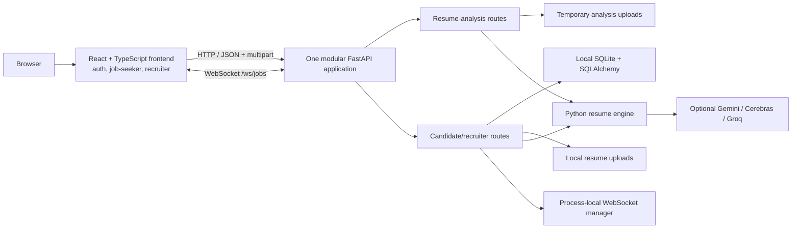
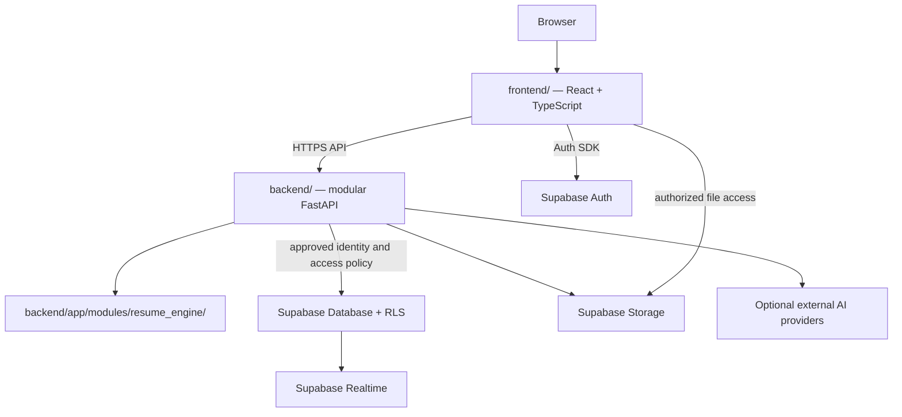
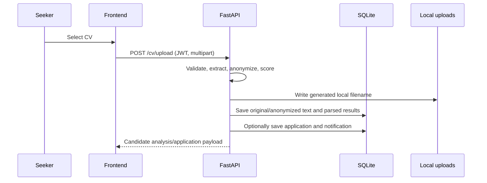

# System Architecture

## 1. Current architecture

The former AI Resume Analyzer and Hire-geni experiences now share one frontend
and FastAPI entry point. Their endpoint families and persistence behavior remain
distinct: resume-analysis requests return transient results, while candidate
and recruiter workflows use local SQLite and local upload storage. Supabase is
not integrated.

### Resume-analysis request flow

1. The seeker resume-analysis pages post a PDF or DOCX to `POST /api/analyze`.
2. The route saves the upload to a temporary directory and calls the resume
   engine for validation, parsing, skill normalization, ATS scoring, and
   recommendations.
3. If an external provider is selected, extracted resume text is sent to that
   configured provider.
4. The route returns JSON and removes the temporary upload. Analysis results
   are held in frontend state and are not written to SQLite.

These API handlers do not declare a JWT dependency. The frontend pages are
nested under a protected route, which is not a substitute for API
authorization.

See `backend/app/modules/resumes/analysis_router.py` and
`backend/app/modules/resume_engine/`.

### Candidate and recruiter request flow

1. The frontend obtains a custom JWT through `/auth/register` or `/auth/login`,
   stores it in browser `localStorage`, and sends it as a bearer token.
2. Protected API routes resolve the user through `backend/app/core/deps.py`,
   then apply role/ownership checks and access SQLAlchemy models in SQLite.
3. CV upload is parsed, anonymized, and scored; the CV record is persisted and
   can optionally create an application.
4. Recruiter actions and candidate reveal approval update application state.
   Notifications are persisted and live events are sent through an
   in-process WebSocket manager.

See `backend/app/modules/*/router.py`, `backend/app/core/`, and
`backend/app/db/`.

## 2. Planned managed-platform integration

The repository layout is already merged. The remaining platform direction is
to replace or integrate local auth, SQLite, file storage, and process-local
realtime with approved Supabase services. This diagram is a target, not the
current deployment.

`supabase/migrations/` and `supabase/functions/` currently contain
placeholders. There is no Supabase client, live-schema verification, or RLS
policy in the application. Edge Functions remain optional and should be added
only for a specific lightweight integration, webhook, or scheduled-task need.

## 3. Frontend architecture

The single frontend uses React 18, TypeScript, Vite, and React Router.

- `frontend/src/app/App.tsx` defines public, seeker, and recruiter routes.
- `frontend/src/modules/auth/` manages the custom JWT session and protected
  routes.
- `frontend/src/modules/job-seeker/` contains seeker workflows and the ported
  resume-analysis pages.
- `frontend/src/modules/recruiter/` contains recruiter workflows;
  shared interview pages are in `frontend/src/modules/shared/`.
- The admin module is not implemented; its scope and permissions remain
  undecided.

## 4. Backend architecture

`backend/app/main.py` creates the FastAPI application and includes
`backend/app/api/router.py`. The router assembles modules for auth, candidates,
applications, jobs, resumes, recruiters, interviews, and notifications.
Resume parsing and ATS/recommendation logic live in
`backend/app/modules/resume_engine/`; shared access, agent, cache, realtime,
and text-extraction helpers live in `backend/app/services/`.

The `admin/`, `organizations/`, and `integrations/` packages are placeholders;
their business workflows and data contracts are not implemented.

## 5. Authentication and authorization

The candidate/recruiter API uses password hashes and custom signed JWTs
(`python-jose`) with a configurable secret. `get_current_user` resolves the
active user and routes enforce role and resource ownership as applicable. The
frontend stores the token in `localStorage`.

The resume-analysis routes do not declare API authentication or ownership
checks. There is no Supabase Auth, organization membership, or RLS integration.
Any replacement identity and tenant policy requires an approved design.

## 6. Resume upload and processing

### Candidate CV upload

The route supports PDF, DOCX, and UTF-8 TXT. PDF/DOCX files are written to the
local `backend/uploads/` directory; parsed resume text and removed PII are
stored in SQLite. These are sensitive records. Local storage is not equivalent
to private managed object storage.

### Resume analysis

The separate `/api/analyze` request path accepts PDF/DOCX, saves the file to a
temporary directory, runs the resume engine, returns structured analysis, and
removes the temporary directory. Results are not stored in SQLite. When a
remote extractor is selected, resume text is sent to the configured external
provider.

The candidate-upload and resume-analysis flows do not share one persistence
contract today. Supabase storage, consent, retention, and cross-feature history
require product and security decisions.

## 7. AI, matching, and ranking

- Resume-analysis ATS scoring measures resume completeness/quality;
  `/api/job-match` uses keyword overlap.
- Candidate/recruiter scoring compares a CV with a job's required skills;
  recruiter ranking and explanations are separate functions.
- Shortlist suggestions are read-only. Application decisions require an
  explicit recruiter action.
- External AI provider behavior is configurable. Scores and recommendations
  are advisory and do not replace recruiter decisions.

## 8. Storage, Realtime, deployment, and boundaries

| Concern | Current | Planned |
|---|---|---|
| Structured data | Local SQLite/SQLAlchemy for candidate and recruiter workflows; no persistence for resume-analysis results | Supabase-managed database with reviewed migrations and RLS |
| Resume files | Candidate uploads use local `backend/uploads/`; analyzer uploads are temporary | Private Supabase Storage with approved ownership rules |
| Authentication | Custom JWT for candidate/recruiter routes; resume-analysis routes have no API auth dependency | Supabase Auth with approved role and ownership policy |
| Notifications | SQLite notification rows plus process-local WebSocket manager | Supabase Realtime or another approved mechanism |
| Secrets | Server environment variables for JWT/AI keys; no Supabase client found | Server-only secrets; no service-role key in browser |
| Deployment | Local development setup is documented; production deployment not verified | Hosting topology and operational requirements remain undecided |
| Edge Functions | None | Optional only for a concrete justified use case |

The WebSocket manager is process-local, not a multi-instance message bus.
Production deployment and live Supabase state have not been verified.

## 9. Related documents

See [ERD](ERD.md) for implemented and proposed data,
[API reference](API_REFERENCE.md) for route contracts,
[security review](SECURITY_REVIEW.md) for risks, and
[implementation roadmap](IMPLEMENTATION_ROADMAP.md) for proposed sequencing.
